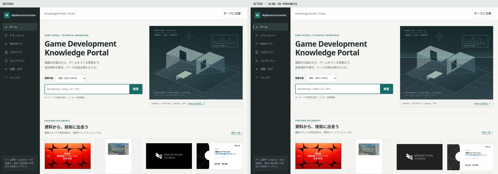

# Technical Motion

Homeでは、ゲーム環境のジオメトリ、ワイヤーフレーム、ライティングを読み取る流れを作る。探索画面では、操作の反応と結果の切り替わりを短い動きで伝える。資料Viewerは、Driveのプレビューと既存の読み込み状態をそのまま表示する。

## 参考と採用判断

参考サイトでは、基本モーションとUIのデモを比較した。ホバーリフトの詳細パネルで、再生速度の変更とポインター操作モードを試した。デモ全体の時間には動作を見比べるための待機や復帰も含まれるため、Portalの時間は操作の頻度と画面内の移動量を基準に選んだ。 [モーションリファレンス](https://motion-reference.takayustudio.jp/index.html)

| 参考デモ | 参考サイトの時間・イージング | Portalでの適用 |
| --- | --- | --- |
| ホバーリフト | デモ 1,600 ms、easeOutCubic。実装目安 100〜150 ms | 150 msで2 px。ポインターのある環境で読み順の見出しやリポジトリアイコンを動かす |
| プレスフィードバック | 420 ms、easeOutCubic | 90 msで1 px。押下状態に追従してすぐに戻る |
| フェード＋スライド | 600 ms、easeOutCubic | Homeの見出しは460 ms。本文に入る詳細ページは150 ms、4 pxに抑える |
| リスト順次表示、スクロールリビール | 760 ms、900 ms、どちらもeaseOutCubic | 特集資料は280 ms、複数列で42 msずつ遅らせる。読み順はビューポートに入ったときに一度だけ動く |
| スキャンライン、スケルトンシマー | 1,100 ms、1,200 ms、どちらも等速 | 技術イラストは920 msで1回。読み込みが360 msを超えたときは1,100 msで最大2回 |
| ビュークロスフェード、ルートスライド | 520 ms、600 ms、どちらもeaseInOutCubic | 現在地マーカーだけを180 msで共有。画面本文はナビゲーション後すぐに操作できる |

ワイヤーフレームは、既存SVGの線が不透明度を増す460 msの演出を採用した。走査光が通ると線と面の関係が見え、静止後も同じ図として読める。ポインター追従のTilt、カード間の共有要素、手動のFLIPは、コンテンツを読み始める位置とクリック領域を安定させるため見送った。

## 実装箇所

- 共通の時間、イージング、移動量、フォーカスハロー、登場キーフレームは [assets/site.css](../assets/site.css) にある。押下、短い反応、サムネイル、登場、Home、遷移の役割に応じてトークンを使う。
- Homeの走査光と特集の段階表示は [assets/home.css](../assets/home.css)、読み順の一度限りの監視は [assets/human-portal.js](../assets/human-portal.js)、メッシュの表示は [assets/technical-environment.svg](../assets/technical-environment.svg) にある。SVGは独立した画像として読み込むため、その内部にHomeと同じ時間と曲線を定義している。
- 一覧のスケルトンは、読み込み結果またはエラー表示と置き換わる。ページ送りで結果を同期描画し、先頭3件だけに短い登場を適用する。検索、フィルター、履歴復元は即時に描画する。ページ送りのあと、最初の結果にフォーカスを移し、高さの低い画面でも表示範囲に入れる。
- 同一オリジンの文書間遷移では、ネイティブView Transitionのスナップショットをナビゲーションの装飾マーカーに限定する。全画面スナップショットでは遷移中に検索欄をクリックできなかったため、本文は通常の描画に切り替えた。ブラウザが遷移を省略した場合も、リンク、フォーカス、現在地表示を使える。資料Viewerは遷移の対象外とし、Viewerへ進む際はブラウザ側でキャプチャを開始する前にキャンセルする。
- Reduced Motionでは、静止したイラスト、スケルトン、現在地マーカーとフォーカス表示を維持する。ホバー時の移動は細かいポインターを備えた環境でのみ有効にする。

## Before / After

左が変更前、右が変更後。デスクトップのHomeは走査光がイラストを通過しているフレームを固定した。モバイルはタッチ入力を有効にして撮影した。



| 画面・状態 | 比較画像 |
| --- | --- |
| Home、Dark、390 px | [Homeモバイル](technical-motion/home-mobile.webp) |
| 特集資料と読み順、スクロール後 | [Reading Paths](technical-motion/home-reading-paths.webp) |
| Homeの検索欄をキーボードでフォーカス | [フォーカスハロー](technical-motion/keyboard-focus.webp) |
| 資料の取得を保留した状態 | [スケルトン](technical-motion/catalog-loading.webp) |
| 資料とWebサイトのカード、Light / Dark | [一覧とサムネイルホバー](technical-motion/catalog-cards.webp) |
| リポジトリ、Light、390 px | [リポジトリ一覧](technical-motion/repository-mobile.webp) |
| リポジトリ詳細とサイドバーの現在地 | [詳細ページとナビゲーション](technical-motion/detail-navigation.webp) |

## ブラウザ検証と性能

Chromium 151でローカルHTTP配信を使用した。変更前は `1914e22`。各試行を新しいブラウザコンテキストで実行し、前後の実行順を交互に入れ替え、CPUを4倍にスロットリングした。初回描画指標とフレーム間隔は読み込み開始後約1.5秒を観測した。検索は取得完了後の10入力の同期処理時間、ページ送りはクリック処理中にURLとDOMが更新されるまでの同期時間を計測した。下表は試行の中央値で、すべて変更前 → 変更後。 [試行ごとのデータ](technical-motion/lab-results.json)

### デスクトップ 1365 × 920、各5回

| 画面 | FCP (ms) | LCP (ms) | レイアウトシフト合計 | 33.4 ms超のフレーム間隔数 | 検索処理 (ms) | ページ送り処理 (ms) |
| --- | ---: | ---: | ---: | ---: | ---: | ---: |
| Home | 424 → 440 | 424 → 508 | 0.020 → 0.020 | 5 → 6 | — | — |
| 資料 | 312 → 332 | 692 → 724 | 0.064 → 0.065 | 5 → 5 | 10.0 → 9.0 | 53.4 → 56.2 |
| Webサイト | 324 → 356 | 800 → 768 | 0.103 → 0.103 | 4 → 5 | 27.6 → 24.8 | 88.5 → 78.4 |
| リポジトリ | 288 → 332 | 288 → 332 | 0.065 → 0.051 | 4 → 3 | 2.5 → 2.6 | — |
| リポジトリ詳細 | 344 → 304 | 568 → 508 | 0.057 → 0.057 | 4 → 4 | — | — |

### モバイルエミュレーション 390 × 844、各3回

| 画面 | FCP (ms) | LCP (ms) | レイアウトシフト合計 | 33.4 ms超のフレーム間隔数 | 検索処理 (ms) | ページ送り処理 (ms) |
| --- | ---: | ---: | ---: | ---: | ---: | ---: |
| Home | 340 → 376 | 340 → 376 | 0.000 → 0.000 | 4 → 5 | — | — |
| 資料 | 280 → 340 | 600 → 664 | 0.000 → 0.000 | 5 → 4 | 10.1 → 14.2 | 47.5 → 69.6 |
| Webサイト | 320 → 296 | 756 → 752 | 0.000 → 0.000 | 4 → 4 | 23.9 → 29.3 | 114.4 → 130.3 |

最初の計測を受けて、Homeではイラスト全体のフェードを外し、スケルトンのシマーの開始を360 msまで遅らせた。最終計測ではデスクトップのLCPの変化は最大84 ms、モバイルではHomeで36 ms、資料で64 ms増えた。資料の起動時のフレーム間隔p95はデスクトップで83 → 117 ms、モバイルで67 → 117 msだった。33.4 msを超える間隔の件数は資料のデスクトップでは同じで、モバイルでは1件減った。Webサイトのページ送りはモバイルの4倍スロットリングで130.3 msとなり、対象リストの全試行でURLは同期的に更新された。ラボ計測値は実機・本番ネットワークのフィールド指標と条件が異なる。

### 回帰検証

- Validate Portalと同じPython・Nodeの検証コマンドを実行した。公開カタログの境界、同期回帰、Viewer、Trend、検索URL、ナビゲーションと既存の描画契約を含む。
- Browser Smokeでは390・768・1280 px、Light／Dark、読み順の表示、読み込み中のReduced Motion、短いモバイル画面の結果フォーカス、入力に伴う即時再描画、View Transition実行中の検索欄のヒットテスト、Viewerの遷移除外を検証した。
- モバイルでView TransitionのオプトインとIntersectionObserverがない状態も再現し、Homeのカード、タッチでの遷移、検索URLを確認した。
- ChromiumがCSSのみの構成でも遷移の中止をスタックなしの `AbortError` として報告することを確認した。Browser Smokeではこのブラウザ通知だけを別扱いにし、Viewerでは同じ通知もエラーとして検出する。

## PR #130 追加レビュー

Homeの取得・描画が完了してから、任意のスクロールリビールを初期化する。IntersectionObserverの未提供、コンストラクター、監視登録、コールバックでの例外をBrowser Smokeで再現し、特集資料と読み順のリンクが表示されたままになることを確認する。Motionの例外は警告として記録する。

### モバイル性能の再計測

初回の3試行と同じ390 × 844、タッチあり、4倍CPUスロットリングで、元のmain `1914e22`、初回PR `6ad7224`、追加修正後の各12試行を比較した。画面ごとに新しいコンテキストを使用し、試行ごとに3条件の開始順を交替した。検索は同じ10入力の同期処理時間の中央値、ページ送りはクリックハンドラー全体の同期時間、フレーム間隔p95は起動時約1.45秒の値を各試行で求めた。

中央値［第1四分位–第3四分位］を示す。初回の3試行で見られたDocuments起動時p95の67 → 117 msは再現しなかった。検索の増加幅も小さく、追加修正後の両検索中央値はmainを下回った。ページ送りは初回PRでmainより資料が10.1 ms、Webサイトが6.2 ms長く、追加修正後はそれぞれ3.4 ms、5.7 ms長かった。ページ送りの本番コードは初回PRと追加修正後で同じため、この2条件の差は測定のばらつきとして扱う。

| 指標 (ms) | main | 初回PR | 追加修正後 |
| --- | ---: | ---: | ---: |
| 資料検索 | 9.9 [7.3–11.7] | 10.2 [9.3–11.9] | 9.1 [8.1–10.3] |
| Webサイト検索 | 27.2 [25.3–29.7] | 29.2 [25.9–31.3] | 26.5 [25.2–27.6] |
| 資料ページ送り | 55.2 [49.5–65.7] | 65.3 [59.7–67.5] | 58.6 [53.8–63.2] |
| Webサイトページ送り | 124.0 [117.8–132.6] | 130.2 [124.8–141.9] | 129.7 [123.7–138.7] |
| 資料 起動時フレーム間隔p95 | 66.6 [45.9–87.6] | 50.0 [45.8–70.8] | 66.5 [33.4–75.1] |
| Webサイト 起動時フレーム間隔p95 | 58.3 [50.0–66.7] | 66.7 [50.1–70.9] | 75.0 [62.5–83.3] |

1.5 × IQRで検出した外れ値も集計に含めた。追加修正後の資料検索 14.1 ms、mainのWebサイト検索 39.3 ms、追加修正後のWebサイト検索 31.4 ms、追加修正後の資料ページ送り 78.7 ms、初回PRのWebサイトページ送り 186.7 ms、追加修正後のWebサイトページ送り 185.3 ms、mainの資料 起動時フレーム間隔p95 199.9 ms、追加修正後のWebサイト 起動時フレーム間隔p95 116.7 ms。生データには全入力、全フレーム間隔、全ページ送りの計時を含む。 [計時データ](technical-motion/mobile-review-runs.json)

### ページ送りのPerformance Trace

| 初回PRの個別トレース | 最初のスクロール (ms) | 2回目のスクロール (ms) | focus (ms) | 最初のStyle Recalculation / Layout (ms) |
| --- | ---: | ---: | ---: | ---: |
| 資料 | 40.3 | 0.3 | 5.7 | 11.3 / 27.2 |
| Webサイト | 122.8 | 計測分解能未満 | 6.0 | 13.2 / 107.8 |

クリック区間のスタックでは、DOMを置き換えた直後の最初の `scrollIntoView` が `UpdateLayoutTree` と強制 `Layout` を同期的に実行している。mainのトレースにも同じ強制レイアウトがあり、最初のスクロールは資料45.8 ms、Webサイト109.1 msだった。追加修正後の最初のスクロールは資料35.8 ms、Webサイト106.5 msだった。フォーカスにもスタイル再計算が含まれた。フォーカスを画面内に入れる2回目のスクロールの削減で大きな改善が見込める根拠は得られず、既存のページ送り、Motion、狭い画面でのフォーカス表示を維持した。各条件・画面のトレースは計時とは別の1試行で、個別トレースの値を中央値との差分として扱わない。 [CDPトレース6件](technical-motion/mobile-review-traces.tar.gz)

Webサイトの起動時p95は追加修正後もmainより高い。また、Webサイトのクリック処理には4倍CPU負荷で185 msを超える試行があり、レイアウト処理は残る。ラボ計測のため、実機の入力から描画までの応答時間は別途評価が必要。

### 再実行

3つの作業ツリーを同じホストからHTTP配信する。以下は修正後のリポジトリルートで実行する例。各HTTPサーバーは別のターミナルで起動する。

```bash
git worktree add --detach /tmp/motion-main 1914e22
git worktree add --detach /tmp/motion-pr 6ad7224
python3 -m http.server 8951 --bind 127.0.0.1 --directory /tmp/motion-main
python3 -m http.server 8952 --bind 127.0.0.1 --directory /tmp/motion-pr
python3 -m http.server 8953 --bind 127.0.0.1
```

```bash
npm ci
npx playwright install chromium
node tools/measure_mobile_motion.cjs /tmp/motion-results 12 \
  http://127.0.0.1:8951/ http://127.0.0.1:8952/ http://127.0.0.1:8953/
```

既存のChromiumを使う場合は `PLAYWRIGHT_CHROMIUM_EXECUTABLE_PATH` を設定する。出力の `runs.json` が計時データで、`*.trace.json` は計時とは別に採取するCDPトレース。Chrome DevToolsのPerformanceで読み込むと、`pagination:start` から `pagination:end` の間に各 `scrollIntoView` と `focus` の区間、Style Recalculationに対応する `UpdateLayoutTree`、`Layout` と呼び出し元スタックを確認できる。試行数を0にするとトレースだけを採取する。

### ブラウザ互換性

- Chromium 151のBrowser Smokeと補足試験で、通常のリンク遷移、Reduced Motion、View Transitionのオプトインを外したときのタッチ遷移・検索・現在地表示を確認した。
- WebKitはPlaywrightのブラウザ配布先がHTTP 403を返し、実行できなかった。Firefoxは同じ配布制限に加え、Debianパッケージから展開したFirefox ESR 140も、実行環境でヘッドレス試験を完了できなかった。両エンジンの動作は未検証。
